<a name="oben"></a>

<div align="center">

# KI4Kids Solutions


|[:skull:ISSUE](https://github.com/KI4kids/05_KI4kids_Solutions/issues?q=is%3Aissue)|[:speech_balloon: Forum /Discussion](https://github.com/KI4kids/05_KI4kids_Solutions/discussions)|[:grey_question:WiKi](https://github.com/KI4kids/05_KI4kids_Solutions/blob/main/wiki.md)|
|--|--|--|
| | | | 
| <a href="https://github.com/KI4kids05_KI4kids_Solutions/pulse" alt="Activity">| <a href="https://github.com/KI4kids/05_KI4kids_Solutions/graphs/traffic">  |<a href="https://github.com/frankyhub?tab=stars"> |

</div>


## KI4Kids Beispiele
- Mengenbestimmung
- Distanzmessung
- Geschwindigkeitsmessung
- Personentracking
- Straßenverkehrszähler
- Objektzähler
- Workout control
- Helm control
- Parkplatz Management

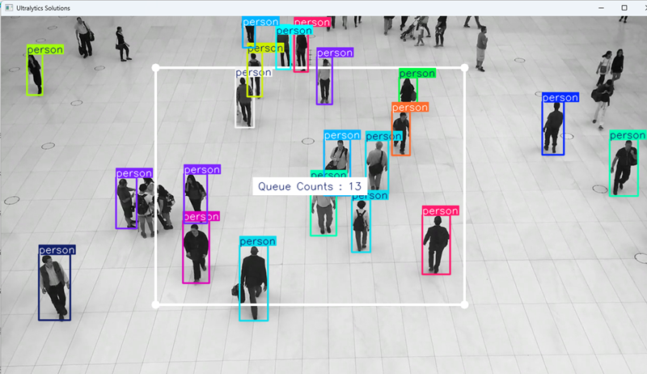

---

### Vorbereitung
- OS Update
- Anaconda installieren
- OpenCV installieren
- Ultralytics installieren
- frankyhub clonen
  
---

### OpenCV installieren

OpenCV

```
pip install opencv-python
```
OpenCV Library

```
pip install opencv-contrib-python
```
Python

```
import cv2
print(cv2.__version__)
```

Kontrolle: '4.10.0'


---


### Ultralytics installieren

bash

```
pip install ultralytics

```

---
### frankyhub clonen

```
git clone https://github.com/frankyhub/count.git
```

---
---

## Mengenbestimmung

Python

```
#ob_count.py
# Zählt Objekte in der queue region

import cv2

from ultralytics import solutions

#cap = cv2.VideoCapture("verkehr.mp4")
cap = cv2.VideoCapture("crossing.mp4")
assert cap.isOpened(), "Fehler beim Lesen der Videodatei"

# Video writer
w, h, fps = (int(cap.get(x)) for x in (cv2.CAP_PROP_FRAME_WIDTH, cv2.CAP_PROP_FRAME_HEIGHT, cv2.CAP_PROP_FPS))
video_writer = cv2.VideoWriter("queue_management.avi", cv2.VideoWriter_fourcc(*"mp4v"), fps, (w, h))

# Definiere den Rahmen
queue_region = [(300, 100), (900, 100), (900, 560), (300, 560)]  # region points

# Warteschlangenmanagerobjekt initialisieren
queuemanager = solutions.QueueManager(
    show=True,  # Zeige die Ausgabe an
    model="yolo11n.pt",  # path t YOLO11 model f
    region=queue_region,  # Passieren von Warteschlangenbereichspunkten
)

# Video
while cap.isOpened():
    success, im0 = cap.read()
    if not success:
        print("Der Videoframe ist leer oder die Verarbeitung ist abgeschlossen.")
        break
    results = queuemanager(im0)

    print(results)  # Greife auf die Ausgabe zu

    video_writer.write(results.plot_im)  # Schreibe in den verarbeiteten Rahmen.
    
    if cv2.waitKey(20) & 0xFF == ord('q'):
        break

#  Taste q beended die Aufnahme
cap.release()
video_writer.release()
cv2.destroyAllWindows()    

```


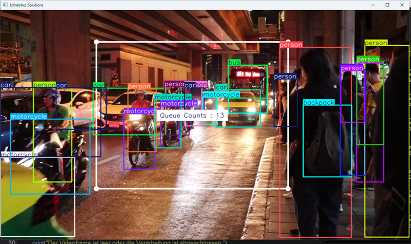

---

## Distanzmessung

Python

```
# distanz.py
# Misst die Distanz zwischen 2 Fahrräder
# Auswahl mit linker Maustaste

import cv2

from ultralytics import solutions

cap = cv2.VideoCapture("fahrrad.mp4")

# Video writer
w, h, fps = (int(cap.get(x)) for x in (cv2.CAP_PROP_FRAME_WIDTH, cv2.CAP_PROP_FRAME_HEIGHT, cv2.CAP_PROP_FPS))
video_writer = cv2.VideoWriter("distance_output.avi", cv2.VideoWriter_fourcc(*"mp4v"), fps, (w, h))

# Initialize distance calculation Solutions
distancecalculator = solutions.DistanceCalculation(
    model="yolo11n.pt",  # path to the YOLO11 model file.
    show=True,  # display the output
    #classes=[2], 
)

# Process video
while cap.isOpened():
    success, im0 = cap.read()

    if not success:
        print("Video frame is empty or processing is complete.")
        break

    results = distancecalculator(im0)

    print(results)  # access the output

    video_writer.write(results.plot_im)  # write the processed frame.

cap.release()
video_writer.release()
cv2.destroyAllWindows()  # destroy all opened windows

```


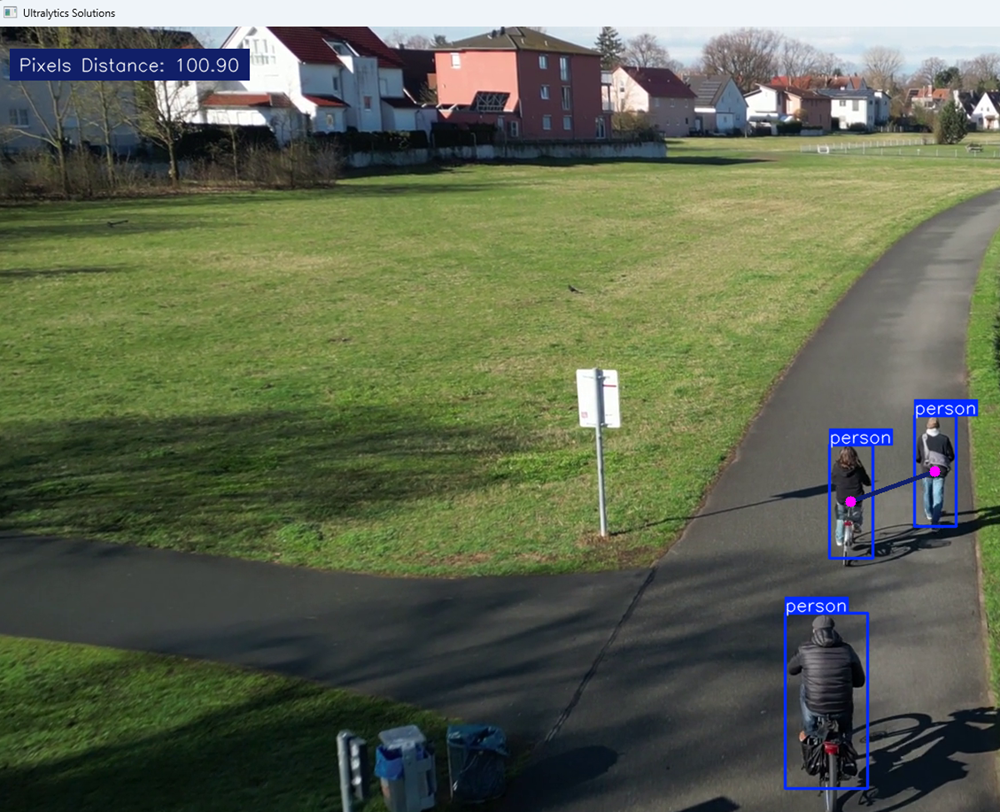

---

## Geschwindigkeitsmessung

Python

```
#speed.py
#Misst die Geschindigkeit von Fahrzeugen

import cv2

from ultralytics import solutions

cap = cv2.VideoCapture("autos3.mp4")
assert cap.isOpened(), "Error reading video file"

# Video writer
w, h, fps = (int(cap.get(x)) for x in (cv2.CAP_PROP_FRAME_WIDTH, cv2.CAP_PROP_FRAME_HEIGHT, cv2.CAP_PROP_FPS))
video_writer = cv2.VideoWriter("speed_management.avi", cv2.VideoWriter_fourcc(*"mp4v"), fps, (w, h))

# speed region points
#speed_region = [(20, 400), (1080, 400), (1080, 360), (20, 360)]
speed_region= [(50, 50), (1030, 50), (1030, 1000), (50, 1000)]

# Initialize speed estimation Solutions
speedestimator = solutions.SpeedEstimator(
    show=True,  # display the output
    model="yolo11n.pt",  # path to the YOLO11 model file.
    region=speed_region,  # pass region points
    # classes=[0, 2],  # estimate speed of specific classes.
    # line_width=2,  # adjust the line width for bounding boxes
)

# Process video
while cap.isOpened():
    success, im0 = cap.read()

    if not success:
        print("Video frame is empty or processing is complete.")
        break

    results = speedestimator(im0)

    # print(results)  # access the output

    video_writer.write(results.plot_im)  # write the processed frame.

cap.release()
video_writer.release()
cv2.destroyAllWindows()  # destroy all opened windows

```

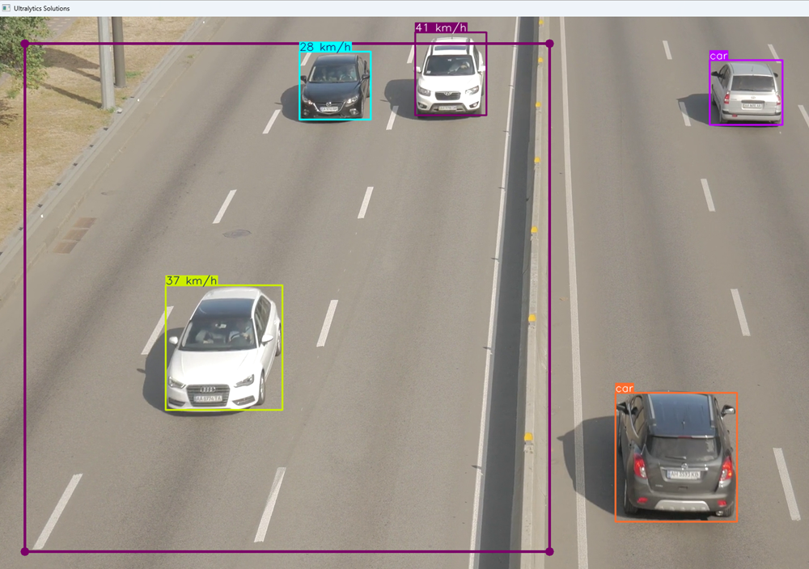


---

## Personentracking

```
# track.py
# Vergibt Personen eine Track-Nummer

import cv2

from ultralytics import solutions

cap = cv2.VideoCapture("crossing.mp4")
assert cap.isOpened(), "Error reading video file"
w, h, fps = (int(cap.get(x)) for x in (cv2.CAP_PROP_FRAME_WIDTH, cv2.CAP_PROP_FRAME_HEIGHT, cv2.CAP_PROP_FPS))

# Define region points
region_points = [(150, 150), (1130, 150), (1130, 570), (150, 570)]

# Video writer
#video_writer = cv2.VideoWriter("Solutions_counting_output.avi", cv2.VideoWriter_fourcc(*"mp4v"), fps, (w, h))

# Init trackzone (Solutions tracking in zones, not complete frame)
trackzone = solutions.TrackZone(
    show=True,  # display the output
    region=region_points,  # pass region points
    model="yolo11n.pt",
)

# Process video
while cap.isOpened():
    success, im0 = cap.read()
    if not success:
        print("Video frame is empty or video processing has been successfully completed.")
        break
    results = trackzone(im0)
 #   video_writer.write(results.plot_im)

cap.release()
video_writer.release()
cv2.destroyAllWindows()

```
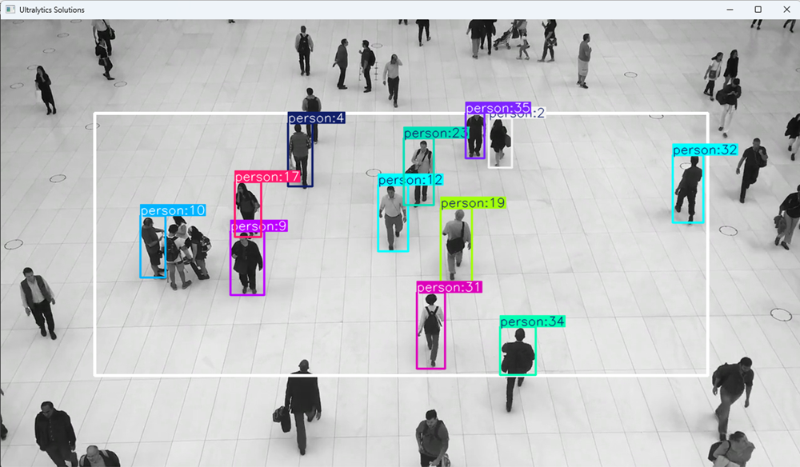

---

## Straßenverkehrszähler

```
#verkehrcount.py  ok V15032025
# Zählt Autos, Personen.... im Straßenverkehr

import cv2

from ultralytics import solutions

#cap = cv2.VideoCapture(0)
cap = cv2.VideoCapture("verkehr.mp4")  #count bikes
w, h, fps = (int(cap.get(x)) for x in (cv2.CAP_PROP_FRAME_WIDTH, cv2.CAP_PROP_FRAME_HEIGHT, cv2.CAP_PROP_FPS))
def change_res(width, height):
    cap.set(3,1200)
    cap.set(4, 720)

change_res(1200,720)
            
region_points = [(150, 20), (800, 20), (800, 650), (150, 650)]


# SolutionsCounter
counter = solutions.SolutionsCounter(
    show=True,  # Display output
    region=region_points,  # region 
    model="yolo11n.pt",  # modell
   # classes=[1],  # class 0: person, 1: bicycle   2: car
    show_in=True,  # Display in counts
)

# Process video
while(True):
    success, source0 = cap.read()
    source0 = counter(source0 )
    
    if cv2.waitKey(20) & 0xFF == ord('q'):
        break

cap.release()
cv2.destroyAllWindows()
```
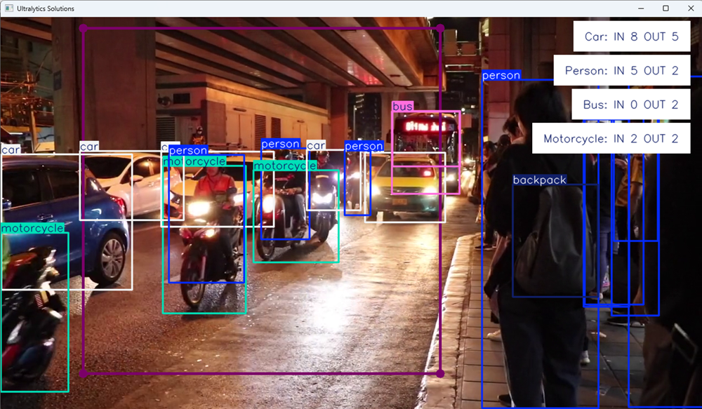

---

## coco Classes

```
# Classes
names:
  0: person
  1: bicycle
  2: car
  3: motorcycle
  4: airplane
  5: bus
  6: train
  7: truck
  8: boat
  9: traffic light
  10: fire hydrant
  11: stop sign
  12: parking meter
  13: bench
  14: bird
  15: cat
  16: dog
  17: horse
  18: sheep
  19: cow
  20: elephant
  21: bear
  22: zebra
  23: giraffe
  24: backpack
  25: umbrella
  26: handbag
  27: tie
  28: suitcase
  29: frisbee
  30: skis
  31: snowboard
  32: sports ball
  33: kite
  34: baseball bat
  35: baseball glove
  36: skateboard
  37: surfboard
  38: tennis racket
  39: bottle
  40: wine glass
  41: cup
  42: fork
  43: knife
  44: spoon
  45: bowl
  46: banana
  47: apple
  48: sandwich
  49: orange
  50: broccoli
  51: carrot
  52: hot dog
  53: pizza
  54: donut
  55: cake
  56: chair
  57: couch
  58: potted plant
  59: bed
  60: dining table
  61: toilet
  62: tv
  63: laptop
  64: mouse
  65: remote
  66: keyboard
  67: cell phone
  68: microwave
  69: oven
  70: toaster
  71: sink
  72: refrigerator
  73: book
  74: clock
  75: vase
  76: scissors
  77: teddy bear
  78: hair drier
  79: toothbrush

```

---

## Kamera  Test

Python

```
#camtest.py

import numpy as np
import cv2

cap = cv2.VideoCapture(0)

while(True):
    # Capture frame-by-frame
    ret, frame = cap.read()

    # Our operations on the frame come here
    gray = cv2.cvtColor(frame, cv2.COLOR_BGR2GRAY)
   
    # Display the resulting frame
    cv2.imshow('frame',frame)
    cv2.imshow('gray',gray)
    if cv2.waitKey(20) & 0xFF == ord('q'):
        break

# When everything done, release the capture
cap.release()
cv2.destroyAllWindows()

```

Mit q beenden

---

## Objektzählung starten

Python

```
## counter.py

#counter.py  ok V15032025
import cv2
from ultralytics import solutions
cap = cv2.VideoCapture(0)
#cap = cv2.VideoCapture("bike.webm")  #count bikes
w, h, fps = (int(cap.get(x)) for x in (cv2.CAP_PROP_FRAME_WIDTH, cv2.CAP_PROP_FRAME_HEIGHT, cv2.CAP_PROP_FPS))
def change_res(width, height):
    cap.set(3,1200)
    cap.set(4, 720)

change_res(1200,720)
            
region_points = [(150, 20), (800, 20), (800, 650), (150, 650)]


# SolutionsCounter
counter = solutions.SolutionsCounter(
    show=True,  # Display output
    region=region_points,  # region 
    model="yolo11n.pt",  # modell
   # classes=[1],  # class 0: person, 1: bicycle   2: car
    show_in=True,  # Display in counts
)

# Process video
while(True):
    success, source0 = cap.read()
    source0 = counter(source0 )
    
    if cv2.waitKey(20) & 0xFF == ord('q'):
        break

cap.release()
cv2.destroyAllWindows()
```


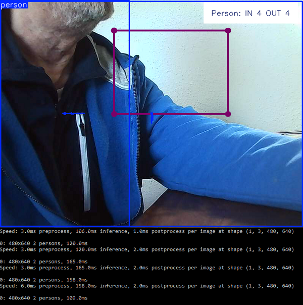


## birdcount.py

Python

```
#birdcount.py  ok V15032025

import cv2

from ultralytics import solutions

#cap = cv2.VideoCapture(0)
cap = cv2.VideoCapture("bird.mp4") #Bird count
w, h, fps = (int(cap.get(x)) for x in (cv2.CAP_PROP_FRAME_WIDTH, cv2.CAP_PROP_FRAME_HEIGHT, cv2.CAP_PROP_FPS))
def change_res(width, height):
    cap.set(3,1200)
    cap.set(4, 720)

change_res(1200,720)
            
region_points = [(100, 120), (300, 120), (300, 450), (100, 450)]


# Init SolutionsCounter
counter = solutions.SolutionsCounter(
    show=True,  # Display the output
    region=region_points,  # Pass region points
    model="yolo11n.pt",  
    classes=[14],  # Bird count
    show_in=True,  # Display counts
)

# Process video
while(True):
    success, source0 = cap.read()
    source0 = counter(source0 )
    
    if cv2.waitKey(20) & 0xFF == ord('q'):
        break

cap.release()
cv2.destroyAllWindows()
```


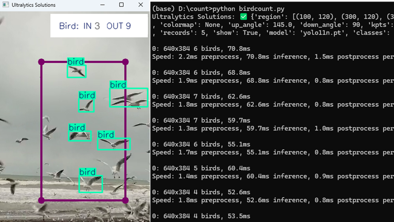


---


## bikecount.py

Python

```
#bikecount.py  ok V15032025

import cv2

from ultralytics import solutions

#cap = cv2.VideoCapture(0)
cap = cv2.VideoCapture("bike.webm")
w, h, fps = (int(cap.get(x)) for x in (cv2.CAP_PROP_FRAME_WIDTH, cv2.CAP_PROP_FRAME_HEIGHT, cv2.CAP_PROP_FPS))
def change_res(width, height):
    cap.set(3,1200)
    cap.set(4, 720)

change_res(1200,720)
            
region_points = [(150, 20), (400, 20), (400, 350), (150, 350)]


# Init SolutionsCounter
counter = solutions.SolutionsCounter(
    show=True,  # Display the output
    region=region_points,  # Pass region points
    model="yolo11n.pt",  # model="yolo11n-obb.pt" for Solutions counting using YOLO11 OBB model.
    classes=[1],  # If you want to count specific classes i.e person and car with COCO pretrained model.
    show_in=True,  # Display in counts
    # show_out=True,  # Display out counts
    # line_width=2,  # Adjust the line width for bounding boxes and text display
)

# Process video
while(True):
    success, source0 = cap.read()
    source0 = counter(source0 )
    
    if cv2.waitKey(20) & 0xFF == ord('q'):
        break

cap.release()
cv2.destroyAllWindows()
```


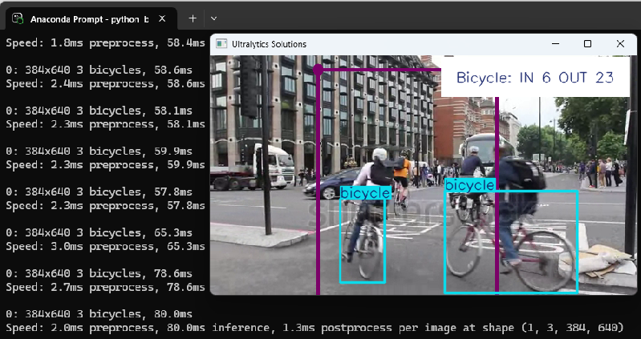

---

## workout.py

Kontrolliert die Körperhaltung bei Workouts

Im Standard-YOLO11-Pose-Modell gibt es 17 Keypoints, die jeweils einen anderen Teil des menschlichen Körpers darstellen. Hier ist die Zuordnung jedes Index zu seinem jeweiligen Körpergelenk:

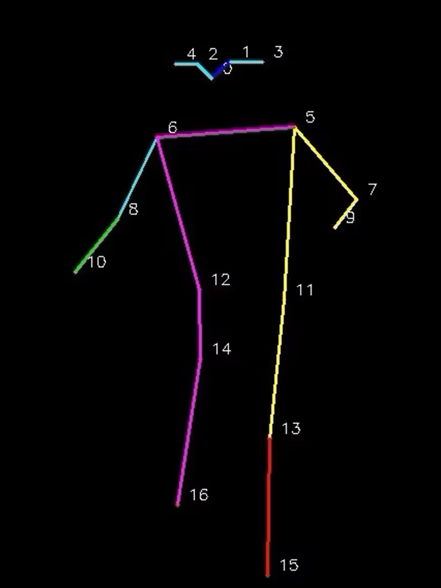


1 Nase

2 Linkes Auge

3 Rechtes Auge

4 Linkes Ohr

5 Rechtes Ohr

6 Linke Schulter

7 Rechte Schulter

8 Linker Ellbogen

9 Rechter Ellbogen

10 Linkes Handgelenk

11 Rechtes Handgelenk

12 Linke Hüfte

13 Rechte Hüfte

14 Linkes Knie

15 Rechtes Knie

16 Linker Knöchel

17 Rechter Knöchel


Python

```
# workout.py
# Kontrolliert die Körperhaltung bei Workouts

import cv2

from ultralytics import solutions

cap = cv2.VideoCapture("workout2.mp4")
assert cap.isOpened(), "Error reading video file"

# Video writer
w, h, fps = (int(cap.get(x)) for x in (cv2.CAP_PROP_FRAME_WIDTH, cv2.CAP_PROP_FRAME_HEIGHT, cv2.CAP_PROP_FPS))
video_writer = cv2.VideoWriter("workouts_output.avi", cv2.VideoWriter_fourcc(*"mp4v"), fps, (w, h))

# Init AIGym
gym = solutions.AIGym(
    show=True,  # display the frame
    kpts=[6, 8, 10],  # keypoints for monitoring specific exercise, by default it's for pushup
    model="yolo11n-pose.pt",  # path to the YOLO11 pose estimation model file
    # line_width=2,  # adjust the line width for bounding boxes and text display
)

# Process video
while cap.isOpened():
    success, im0 = cap.read()

    if not success:
        print("Video frame is empty or processing is complete.")
        break

    results = gym(im0)

    # print(results)  # access the output

    video_writer.write(results.plot_im)  # write the processed frame.

cap.release()
video_writer.release()
cv2.destroyAllWindows()  # destroy all opened windows
```

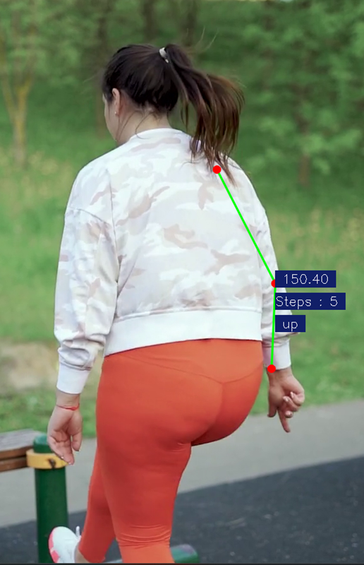

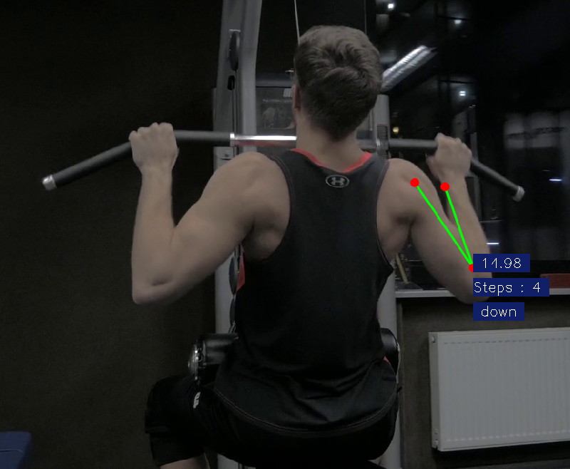

---
## Helmet control

```
git clone https://github.com/frankyhub/helmet_control.git
```

```
#training.py
#pip install ultralytics

from ultralytics import YOLO

# Load a model
model = YOLO("yolov8n.yaml")  # build a new model from scratch
model = YOLO("yolov8n.pt")  # load a pretrained model (recommended for training)

# Use the model
#results = model.train(data=r"D:\Helmet-Detection-using-YOLOv8-main\Bike Helmet Detection.v2-more-preprocessing-augmentation.yolov8\data.yaml", epochs=100)  # train the model
results = model.train(data=r"D:\he\helmet_control\data.yaml", epochs=1)  # train the model
```

```
# Helmet detect
# detect.py

from ultralytics import YOLO
model = YOLO("helmet.pt")  
#results = model("helmet.mp4", save=True, show=True)
#results = model("ub_arch.mp4", save=True, show=True)
results = model("biker.mp4", save=True, show=True)
#results = model("baustelle.mp4", save=True, show=True)

```

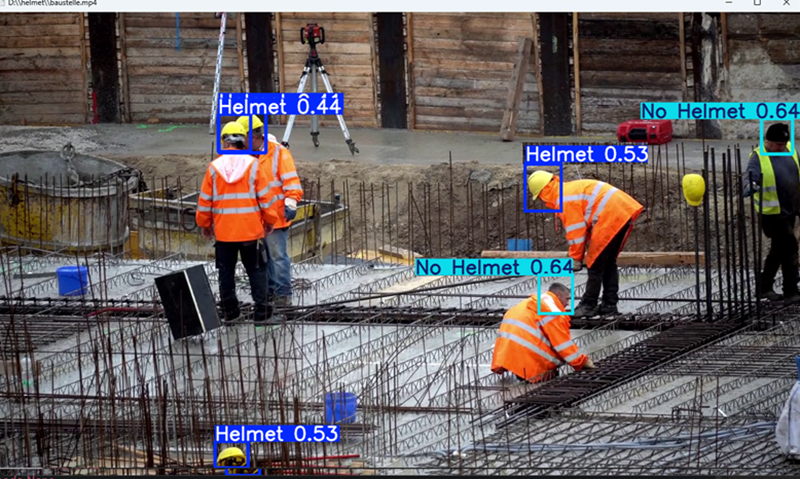

---
## Parkplatzmanagement

```
# trainer.py
import cv2
from ultralytics import solutions
solutions.ParkingPtsSelection()
```

```
# parkplatz.py
import cv2

from ultralytics import solutions

# Video capture
cap = cv2.VideoCapture("parkv.mp4")
assert cap.isOpened(), "Error reading video file"

# Video writer
w, h, fps = (int(cap.get(x)) for x in (cv2.CAP_PROP_FRAME_WIDTH, cv2.CAP_PROP_FRAME_HEIGHT, cv2.CAP_PROP_FPS))
video_writer = cv2.VideoWriter("parking management.avi", cv2.VideoWriter_fourcc(*"mp4v"), fps, (w, h))

# Initialize parking management Solutions
parkingmanager = solutions.ParkingManagement(
    model="yolo11n.pt",  # path to model file
    json_file="bounding_boxes.json",  # path to parking annotations file
)

while cap.isOpened():
    ret, im0 = cap.read()
    if not ret:
        break

    results = parkingmanager(im0)

    # print(results)  # access the output

    video_writer.write(results.plot_im)  # write the processed frame.

cap.release()
video_writer.release()
cv2.destroyAllWindows()  # destroy all opened windows
```

## bounding_boxes.json

```
[
    {
        "points": [
            [
                44,
                208
            ],
            [
                134,
                204
            ],
            [
                134,
                413
            ],
            [
                43,
                415
            ]
        ]
    },
    {
        "points": [
            [
                141,
                206
            ],
            [
                229,
                204
            ],
            [
                230,
                416
            ],
            [
                141,
                414
            ]
        ]
    },
    {
        "points": [
            [
                234,
                204
            ],
            [
                326,
                204
            ],
            [
                329,
                418
            ],
            [
                235,
                416
            ]
        ]
    },
    {
        "points": [
            [
                331,
                205
            ],
            [
                425,
                203
            ],
            [
                424,
                417
            ],
            [
                337,
                419
            ]
        ]
    },
    {
        "points": [
            [
                430,
                204
            ],
            [
                522,
                203
            ],
            [
                526,
                416
            ],
            [
                430,
                415
            ]
        ]
    },
    {
        "points": [
            [
                527,
                202
            ],
            [
                618,
                202
            ],
            [
                619,
                413
            ],
            [
                530,
                416
            ]
        ]
    },
    {
        "points": [
            [
                623,
                202
            ],
            [
                710,
                200
            ],
            [
                712,
                415
            ],
            [
                624,
                414
            ]
        ]
    }
]
```


---

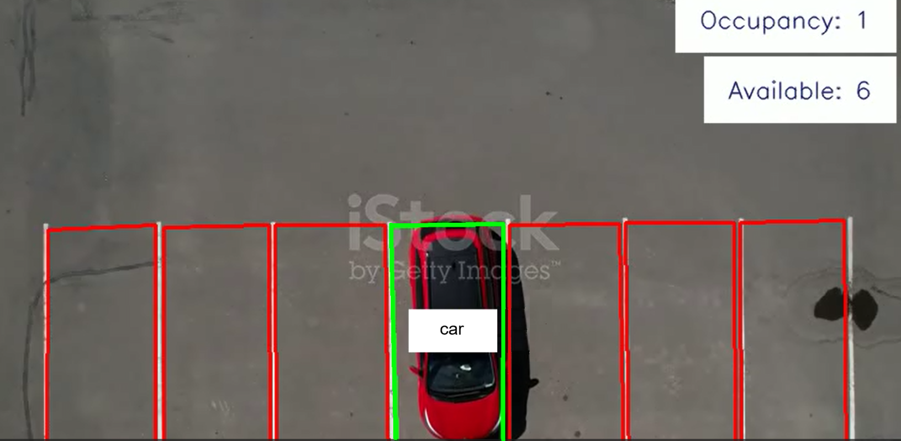

---

<div style="position:absolute; left:2cm; ">   
<ol class="breadcrumb" style="border-top: 2px solid black;border-bottom:2px solid black; height: 45px; width: 900px;"> <p align="center"><a href="#oben">nach oben</a></p></ol>
</div>  

---


